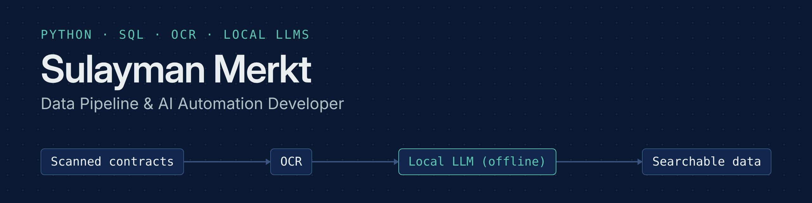

I build data pipelines and automation for businesses buried in manual work: spreadsheet chaos, repetitive data entry and disconnected tools.

Right now I'm working with a petroleum trading consultancy. Their contracts are confidential, so I run everything locally: llama.cpp compiled from source on an old ThinkPad with no GPU, plus an OCR pipeline that makes scanned contract packets searchable. It saves the team 10 to 15 hours a week per person, with no API costs.

### Projects

| Project | What it is |
| --- | --- |
| [Numpy_Digit_Recognizer](https://github.com/USERNAME/Numpy_Digit_Recognizer) | A neural network written in NumPy only, no ML frameworks. Reaches 92.8% accuracy on held-out handwritten digits after testing extra layers, Xavier initialization and learning rates. |
| [School_District_Analysis](https://github.com/USERNAME/School_District_Analysis) | pandas analysis of 39,170 students across 15 schools. Shows that school type, not spending, explains the gap in passing rates. |
| [make_repos_private](https://github.com/USERNAME/make_repos_private) | Small Python utility that uses the GitHub API to switch repositories to private. |

### Tools I use

Python (pandas, NumPy), SQL (PostgreSQL), R, JavaScript, local LLMs (llama.cpp), OCR, Linux (Arch), Tableau, Matplotlib, Jupyter

### Contact

[LinkedIn](https://www.linkedin.com/in/sulayman-merkt) · sully.merkt@gmail.com

Work authorization: USA and Egypt. Open to remote work worldwide.
